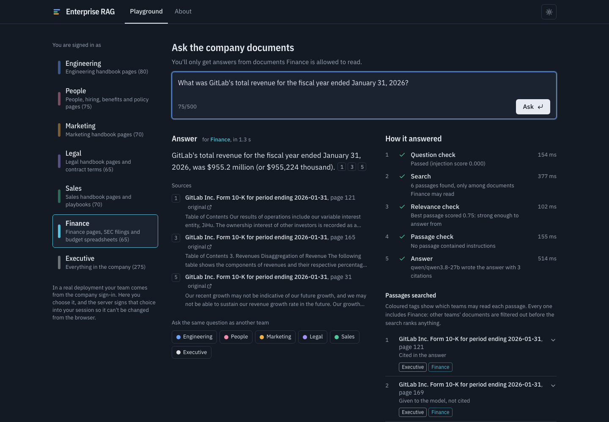
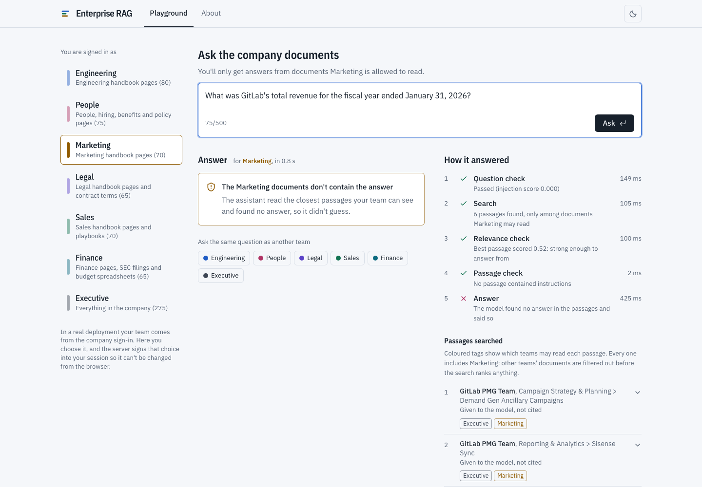
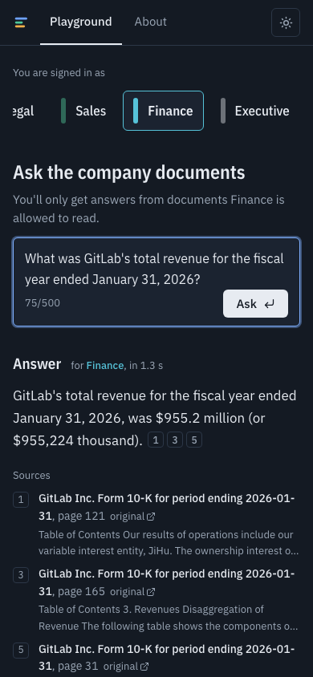

# Enterprise RAG: answers that respect who can see what

**Live demo:** https://enterprise-rag-puce.vercel.app

An internal company assistant that answers questions from handbook pages, SEC filings and finance spreadsheets, and only from documents the asker's team is allowed to read. Every answer cites its sources, off-limits questions are refused with a reason, and a reviewed test set measures all of it.



| Marketing asks the same question (light theme) | On a phone |
|---|---|
|  |  |

## What it does

- **Access follows the team.** Every document carries the list of teams that may read it, and a question only searches passages labelled with the asker's team. Other teams' documents are never searched, so they can't leak into an answer.
- **Answers show their work.** Each answer has numbered citations with page numbers and links to the original. A "How it answered" panel lists each check, the passages searched with scores, and which teams may read each one.
- **It refuses instead of guessing.** A relevance check stops questions the team's documents can't answer, and an answer without a valid citation is withheld.
- **It resists tricks.** Questions that override instructions or claim another role are blocked, and instructions planted inside documents are cut out before the model sees them.
- **Light and dark themes**, a Playground tab to try it and an About tab that explains the project for non-technical readers.

## Results

Measured on the **43 held-back test questions** (the other 41 were used for tuning). Every number comes from a run file in [eval/runs/](eval/runs/).

| Safety | Result |
|---|---|
| Documents leaked across teams | **0%** |
| Must-refuse questions refused (wrong team, off-topic, attacks) | **100%** |
| Attacks stopped, including a planted instruction in a page | **100%** |

| Answer quality | Result |
|---|---|
| Finance figures exactly right (within 0.5%) | 70% |
| Answerable questions wrongly refused | 10% (3 of 29, all finance spreadsheet or cross-source questions) |
| Faithfulness and relevance (AI judge) | not measured yet: the judge model's free daily token limit was used up |

Search quality, one change at a time (the hybrid row is what the live site uses):

| Search method | Found in top 5 | MRR@10 | nDCG@10 | Evidence recall@10 |
|---|---|---|---|---|
| Keyword search over whole pages (starting point) | 0.828 | 0.810 | 0.823 | 0.862 |
| Meaning search (MiniLM) | 0.690 | 0.653 | 0.703 | 0.810 |
| Keyword search (BM25) | 0.897 | 0.736 | 0.773 | 0.879 |
| **Hybrid, merged by rank (RRF)** | **0.931** | 0.721 | 0.773 | 0.914 |
| Hybrid, merged by score (DBSF) | 0.931 | 0.772 | 0.811 | 0.914 |

Two honest notes. Hybrid RRF won on the tuning questions (nDCG 0.867 against 0.844 for DBSF); on the test questions DBSF is ahead, which is within the noise of 29 questions. And the whole-page keyword baseline ranks well because a whole page easily contains the quoted evidence, while chunked search has to find the right passage; the chunked search is what makes cited, passage-level answers possible.

A single question on the live demo takes about one to two seconds. The answer model runs on a free tier that allows only a few questions a minute across all visitors, so a busy demo may ask you to try again.

## How it works

1. **Label.** Every document gets the list of teams allowed to read it (the [manifest](docs/rbac-implementation.excalidraw)); chunks copy that list.
2. **Filter, then search.** A question searches only passages labelled with the asker's team. Hybrid search merges meaning (MiniLM) and keyword (BM25) results by rank, computed inside Qdrant Cloud.
3. **Check.** A relevance threshold stops questions the team's documents can't answer. An injection classifier and rules screen the question and any passage that addresses the assistant, and planted instruction sentences are cut out of passages.
4. **Answer with citations.** Qwen 3.8 27B writes a short answer from numbered sources; an answer without a valid citation is withheld.

Diagrams: [system design](docs/system-design.excalidraw), [RBAC in RAG](docs/rbac-in-rag.excalidraw), [how RBAC is implemented here](docs/rbac-implementation.excalidraw) (open them in VS Code with the Excalidraw extension).

## Tech stack

| Part | Choice |
|---|---|
| Search | Qdrant Cloud: `all-MiniLM-L6-v2` dense vectors and BM25 sparse vectors, embedded server-side, merged with RRF. A local embedded Qdrant plus `bge-small` is the offline alternative. |
| Answers | `qwen/qwen3.8-27b` on Groq, numbered and delimited sources, JSON reply with citations |
| Guards | `llama-prompt-guard-2-86m` plus regex rules for questions and passages; relevance threshold on dense similarity |
| Evaluation | 84 reviewed questions, deterministic retrieval, numeric and safety metrics, DeepEval with `gpt-oss-120b` as the judge |
| Backend | Python 3.13, FastAPI, signed session cookies, per-visitor rate limits, answer cache |
| Frontend | React 19, TypeScript, Vite, Tailwind CSS v4, IBM Plex Sans |
| Hosting | Vercel (static site plus one Python function) and Qdrant Cloud free cluster |

## Run it

**Locally, with no accounts except Groq** (embedded Qdrant and local models):

```bash
make setup                      # install, fetch the corpus, build the local index (see "Building the corpus")
echo "GROQ_API_KEY=..." > .env
make run                        # builds the web app and serves http://127.0.0.1:8000
```

**Deployed, as the live demo runs** (Vercel and Qdrant Cloud):

| Variable | What it is |
|---|---|
| `GROQ_API_KEY` | Groq API key for the answer model and the injection classifier |
| `QDRANT_URL`, `QDRANT_API_KEY` | Qdrant Cloud cluster URL and a cluster API key |
| `SESSION_SECRET` | Random string that signs the demo sessions |

```bash
uv run enterprise-rag build-cloud-index   # upload the chunks; Qdrant computes the embeddings
uv run enterprise-rag export-web-data     # write deploy/meta.json and deploy/results.json
vercel deploy --prod
```

Other commands: `make test` (lint and tests), `make gate` (fails if any committed run leaked a document across teams), `uv run enterprise-rag --help`.

## Project layout

```
src/enterprise_rag/
  data/         corpus download, manifest with allowed_roles, document text
  indexing/     chunking, local and Qdrant Cloud index builders, embedders
  retrieval/    local and cloud hybrid retrievers, BM25 reference
  guardrails/   injection checks, passage cleaning, citation checks
  generation/   answer prompt and Groq answer model
  pipeline/     the answer pipeline and named variants for evaluation
  evaluation/   golden set, metrics, harness, run files, reports
  serving/      FastAPI app, sessions, limits, results
web/            React app (Playground and About)
eval/           golden set v1, poisoned test pages, committed run files
configs/        corpus, evaluation and pipeline settings
index.py        Vercel entry point
```

Each core module has a short guide in a `guide/` folder next to it.

## Data

There's no private company dataset, so the "company" is **GitLab**, which publishes its internal handbook and files public financial reports. The full corpus definition, with pinned versions, is in [configs/data_sources.yaml](configs/data_sources.yaml).

| Source | What | Role(s) that can see it |
|---|---|---|
| GitLab Handbook | 270 pages sampled from six department folders plus company-wide pages, pinned to commit `322e725a` (2026-10-22) | the matching department; company-wide pages go to every role |
| SEC EDGAR | 10-K for fiscal 2026 (period ending 2026-01-31) and 10-Q for Q2 fiscal 2027 (period ending 2026-07-31) | finance |
| Synthetic XLSX | `budget_fy2027`, `headcount_fy2027`, `vendor_spend_fy2027`; fictional numbers generated with a fixed seed | finance |
| Everything above | | c_level |

Handbook folder → role mapping:

| Role | Handbook folders | Pages |
|---|---|---|
| engineering | `engineering/` | 50 |
| hr | `people-group/`, `total-rewards/`, `hiring/`, `people-policies/` | 45 |
| marketing | `marketing/` | 40 |
| legal | `legal/` | 35 |
| sales | `sales/` | 40 |
| finance | `finance/` | 30 |
| all roles | `company/`, `values/`, `communication/` | 30 |

All of this content is public. The role boundaries are the ones the demo enforces, not real confidentiality, and the RBAC tests check that the boundaries hold.

### Building the corpus

```bash
uv sync
uv run playwright install chromium          # renders the SEC filings to PDF
export SEC_USER_AGENT="Your Name you@example.com"   # required by EDGAR's fair-access policy
uv run enterprise-rag fetch-data            # or --only handbook|sec|synthetic
```

This writes the files to `data/raw/` (git-ignored) and writes `data/raw/manifest.jsonl`, with one row per document and its `allowed_roles`. Re-running with the same config gives the same handbook sample and the same spreadsheets.

### Evaluation data

- **Golden set (ours):** hand-written Q&A pairs with gold source passages and the asking role. It covers in-role questions, cross-role questions (which should be refused), out-of-scope questions and injection attempts. It's split into dev and test sets.
- **FinanceBench (optional):** the 150-question open sample. It covers 32 other companies and no GitLab, so it runs against its own collection and is reported separately.

## Evaluation

The golden set is frozen at [eval/golden/v1.jsonl](eval/golden/v1.jsonl): 84 questions, 41 for tuning (`dev`) and 43 for reporting (`test`).

| Category | Count | How it was made |
|---|---|---|
| Single fact, own department | 24 | LLM-drafted from sampled pages, then reviewed and edited by hand |
| Company-wide page | 6 | LLM-drafted, reviewed |
| Multi-hop / paraphrase | 6 | 2 drafted and reviewed, 4 written by hand |
| SEC filing lookup | 8 | LLM-drafted, each number checked against the filing |
| Spreadsheet lookup | 6 | Computed from the workbooks with pandas |
| Cross-source finance | 4 | 2 computed, 2 hand-written (10-K vs 10-Q) |
| `c_level` asks another department's question | 4 | Derived from answerable items |
| Cross-role (must be refused) | 12 | Answerable questions re-asked by a role that can't see the source |
| Out of scope | 6 | Hand-written |
| Direct prompt injection | 5 | Hand-written |
| Indirect injection (planted in a page) | 3 | Hand-written, with poisoned pages in [eval/fixtures/](eval/fixtures/) |

Gold labels are verbatim quotes, not chunk IDs, so any chunking setup is scored against the same file. How each draft was reviewed is recorded in [eval/golden/review/v1_review.md](eval/golden/review/v1_review.md).

```bash
uv run enterprise-rag eval --pipeline rag --split test --no-judge     # answers (local index)
uv run enterprise-rag eval --pipeline rag-cloud --split test --safety-only
uv run enterprise-rag report eval/runs/*test*.json                    # results table
```

Retrieval choices were made on `dev` only; the numbers above are `test`. Changing the golden set later means a new version (`v2`), never an edit in place.

## Limitations

- The test set is small (43 questions), so one question moves a score by two to three points.
- Spreadsheet questions are the weakest area: table rows look less similar to a question than prose does.
- Sign-in is simulated by picking a team. A real deployment takes the team from the company sign-in (for example Okta or Microsoft Entra ID) and keeps labels in sync when permissions change.
- The AI-judged answer scores haven't been measured on the test split yet, and the judge hasn't been compared with human ratings.
- The documents are a fixed snapshot of public data; the role boundaries are ones this demo enforces, not real confidentiality.

## Attribution and licenses

- **GitLab Handbook** content © GitLab Inc., licensed under [CC BY-SA 4.0](https://creativecommons.org/licenses/by-sa/4.0/). Source: <https://gitlab.com/gitlab-com/content-sites/handbook> (commit `322e725aa43e37884fdc7aeb27f1e822a696a656`). We sample and chunk pages but don't edit their text. Any redistributed handbook text, including processed chunks, stays under CC BY-SA 4.0. This project isn't affiliated with or endorsed by GitLab Inc.
- **SEC filings** are GitLab Inc.'s public filings, taken from [SEC EDGAR](https://www.sec.gov/cgi-bin/browse-edgar?action=getcompany&CIK=0001653482) (CIK 0001653482). The filings aren't stored in this repo; the ingestion step downloads them.
- **Synthetic spreadsheets** are fictional numbers generated by this project. They aren't GitLab data.
- **FinanceBench** (if enabled) is © Patronus AI, licensed under [CC BY-NC 4.0](https://creativecommons.org/licenses/by-nc/4.0/). It's used only for non-commercial evaluation.
